  

  
  
  
  

---

## 👋 About me

<table>
<tr>
<td width="58%" valign="top">

I'm **Uday**, a second-year **B.Tech CSE student at Aditya University** who builds full-stack web apps and voice-first tools. I like products that load fast, work offline where they can, and explain themselves without a manual.

Right now most of my time goes into **RakshaCall** — a browser-only scam-call guard that checks whether the caller really is the relative they claim to be.

- 🎓 **B.Tech CSE** @ Aditya University
- 🔭 Building **local-first, privacy-respecting web apps**
- 🐍 Exploring **speech recognition, LLMs, and desktop automation**
- 📷 Off the keyboard: behind a camera — my portfolio is part photo journal
- 💬 Ask me about **React, Node/Express, or shipping without a backend**
- ⚡ Fun fact: I'd rather ship a small thing that works than a big thing that doesn't

</td>
<td width="42%" valign="top">

</td>
</tr>
</table>

---

## 🛠️ Tech stack

  

**Frontend**

**Backend & Data**

**Tooling**

---

## 📊 GitHub in numbers

---

## 🚀 Featured projects

<table>
<tr>
<td width="50%" valign="top">

### 🛡️ RakshaCall

A local-first scam-call guard. It learns your family's real voices and flags impersonation or cloned-voice calls — entirely in the browser, with no backend and no uploads.

`React` `Vite` `Web Audio` `PWA`

[**Live app**](https://udaysaireddy18.github.io/rakshacall/) · [**Source**](https://github.com/udaysaireddy18/rakshacall)

</td>
<td width="50%" valign="top">

### 🎙️ Siri Desktop Assistant

A Windows AI assistant you talk to: speech recognition, laptop control, reminders, and a study companion for B.Tech subjects.

`Python` `PySide6` `Groq` `TTS`

[**Source**](https://github.com/udaysaireddy18/siri-desktop-voice-assistant)

</td>
</tr>
<tr>
<td width="50%" valign="top">

### 🏦 Bank Management System

A DBMS project with a real client–server split: a dependency-free JavaScript frontend talking to a typed Node/Express REST API.

`Node.js` `Express` `JavaScript` `SQL`

[**Source**](https://github.com/udaysaireddy18/BankMangementSystem)

</td>
<td width="50%" valign="top">

### 💼 Portfolio

A dark-first, glassmorphic portfolio for a developer who also shoots photos — typed, accessible, and keyboard-friendly.

`React` `TypeScript` `Vite`

[**Source**](https://github.com/udaysaireddy18/portfolio)

</td>
</tr>
</table>

<b>📌 What I'm looking for next</b>

 

| Area | What I want to work on |
| :--- | :--- |
| 🌐 **Products** | End-to-end web apps with real users and measurable impact |
| 🧱 **Craft** | Design systems, accessibility, and developer experience |
| 🤖 **Applied AI** | Voice and LLM features that solve one concrete problem well |
| 🎓 **Internship** | A team where I can ship in production and learn from reviews |

---

## 🐍 Contribution snake

<picture>
  <source media="(prefers-color-scheme: dark)" srcset="https://raw.githubusercontent.com/udaysaireddy18/udaysaireddy18/output/github-snake-dark.svg" />
  <source media="(prefers-color-scheme: light)" srcset="https://raw.githubusercontent.com/udaysaireddy18/udaysaireddy18/output/github-snake.svg" />
  
</picture>

---

## 🤝 Connect

  

<i>“First make it work, then make it right, then make it fast.”</i>

  

