<div align="center">
  <a href="https://github.com/udaysaireddy18">
    
  </a>
</div>

<div align="center">

<a href="https://udaysaireddy18.github.io/">
  
</a>

<p>
  <a href="https://github.com/udaysaireddy18?tab=followers"></a>
  
  
  
</p>

<a href="https://udaysaireddy18.github.io/"></a>

</div>

<br/>

```console
uday@github:~$ whoami
┌─[ udaysaireddy18 ]
├─ name .... M Uday Sai Reddy
├─ role .... full-stack web developer
├─ edu ..... B.Tech CSE · 2nd year · Aditya University
├─ loc ..... India
└─ status .. open to internships

uday@github:~$ cat /etc/motd
"First make it work. Then make it right. Then make it fast."

uday@github:~$ _
```

<div align="center">
<sub>the same terminal, but interactive — <a href="https://udaysaireddy18.github.io/">udaysaireddy18.github.io</a></sub>
</div>

---

## `$` whoami

<table>
<tr>
<td width="58%" valign="top">

I build **full-stack web apps** and **voice-first tools** — the kind that load fast, keep user data on the device, and explain themselves without a manual.

Most of my time goes into **[RakshaCall](https://github.com/udaysaireddy18/rakshacall)**, a browser-only scam-call guard that learns your family's real voices and flags impersonation or cloned-voice calls. No backend, no uploads.

```diff
+ currently  building local-first, privacy-respecting apps
+ learning   speech recognition · LLMs · desktop automation
+ asking     why does this need a server at all?
- never      shipping a spinner where a skeleton would do
```

</td>
<td width="42%" valign="top">


</td>
</tr>
</table>

---

## `$` ls -la stack/

<div align="center">


<br/><br/>


</div>

```console
uday@github:~$ stack --summary
languages   TypeScript · JavaScript · Python · SQL
frontend    React · Vite · Tailwind · HTML/CSS
backend     Node · Express · REST · PySide6
data        MySQL · MongoDB
tooling     Git · GitHub Actions · Vercel · Figma
uday@github:~$ _
```

---

## `$` ls projects/

<table>
<tr>
<td width="50%" valign="top">

### `[01]` rakshacall

A local-first scam-call guard. Learns your family's real voices and flags impersonation or cloned-voice calls — entirely in the browser.

`React` `Vite` `Web Audio` `PWA`

[`live`](https://udaysaireddy18.github.io/rakshacall/) · [`src`](https://github.com/udaysaireddy18/rakshacall)

</td>
<td width="50%" valign="top">

### `[02]` siri-desktop-voice-assistant

A Windows AI assistant you talk to: speech recognition, laptop control, reminders, and a study companion for B.Tech subjects.

`Python` `PySide6` `Groq` `TTS`

[`src`](https://github.com/udaysaireddy18/siri-desktop-voice-assistant)

</td>
</tr>
<tr>
<td width="50%" valign="top">

### `[03]` BankMangementSystem

A DBMS project with a real client–server split: dependency-free JavaScript frontend talking to a typed Node/Express REST API.

`Node.js` `Express` `JavaScript` `SQL`

[`src`](https://github.com/udaysaireddy18/BankMangementSystem)

</td>
<td width="50%" valign="top">

### `[04]` portfolio

A dark-first, glassmorphic portfolio for a developer who also shoots photos — typed, accessible, keyboard-friendly.

`React` `TypeScript` `Vite`

[`src`](https://github.com/udaysaireddy18/portfolio)

</td>
</tr>
</table>

<details>
<summary><code>$ cat roadmap.md</code></summary>

<br/>

```diff
+ products   end-to-end web apps with real users and measurable impact
+ craft      design systems, accessibility, developer experience
+ applied ai voice and LLM features that solve one concrete problem well
! next       an internship where I ship to production and get reviewed
```

</details>

---

## `$` stats --github

<div align="center">


</div>

---

## `$` ./contact

<div align="center">

<a href="mailto:udaysaireddy181@outlook.com"></a>
<a href="https://github.com/udaysaireddy18"></a>
<a href="https://udaysaireddy18.github.io/"></a>
<a href="https://udaysaireddy18.github.io/rakshacall/"></a>

<br/><br/>

```console
uday@github:~$ echo "thanks for stopping by"
thanks for stopping by
uday@github:~$ exit
connection to github.com closed.
```

</div>

<div align="center">
  
</div>
